# gitsong

**Your GitHub contribution graph, played as a song.**

<a href="https://madhavbuilds.github.io/gitsong/"></a>

### ▶ [Listen to it](https://madhavbuilds.github.io/gitsong/) · [watch the video (with sound)](docs/madhavbuilds.mp4) · [download the WAV](docs/madhavbuilds.wav)

A year of commits is 53 weeks × 7 days. That's a sequencer grid. gitsong reads anyone's
public contribution graph and composes it into about 40 seconds of music. It needs no
token, no API key and no dependencies.

```bash
git clone https://github.com/madhavbuilds/gitsong
cd gitsong
python gitsong.py your-github-username
```

```
@madhavbuilds: 1,001 contributions over 53 weeks. Composing...
38.8s of audio -> out/madhavbuilds.wav, madhavbuilds.svg, madhavbuilds.html
```

You get three files:

| File | What it is |
| --- | --- |
| `out/<user>.wav` | The song. 44.1 kHz stereo. |
| `out/<user>.svg` | An animated graph that lights up in time with the music. You can drop it into your profile README. |
| `out/<user>.html` | A player page that plays the WAV with the graph and a playhead. Click anywhere to seek. |
| `out/<user>.mp4` | With `--video`: a square 1080×1080 video with sound, ready to post. Needs Pillow and ffmpeg. |

## How the graph becomes music

| Graph | Music |
| --- | --- |
| One week (a column) | One beat |
| One day (a cell) | One note. Sunday to Saturday plays as a fast arpeggio, low to high |
| Which week it is | The chord. It moves i → VI → III → VII every four weeks |
| How dark the cell is | How hard the note hits. Your best days also get an octave-up shimmer |
| A busy week | Bass on the downbeat. A kick if the week was very busy, plus hats and snare |
| A week off | Silence, except for the pad. You can hear every break you took |

All of it is synthesised from scratch in plain Python: wavetable oscillators, envelopes, a
pitch-swept kick, noise drums and a ping-pong echo. Then it's soft-clipped and normalised.

## Options

```bash
python gitsong.py torvalds --bpm 120          # faster
python gitsong.py gaearon --key A             # A minor instead of D minor
python gitsong.py you --json data.json        # from a saved GraphQL contributionCalendar
python gitsong.py you --out somewhere/        # choose the output folder
python gitsong.py you --video                 # also render a square MP4 to post (pip install pillow, plus ffmpeg)
```

## Put it on your profile

Run it, commit `out/<user>.svg` and the WAV to your profile repo, and link one to the other:

```html
<a href="out/you.wav"></a>
```

## License

MIT. Made by [Madhav Panchal](https://madhavpanchal.com/).
